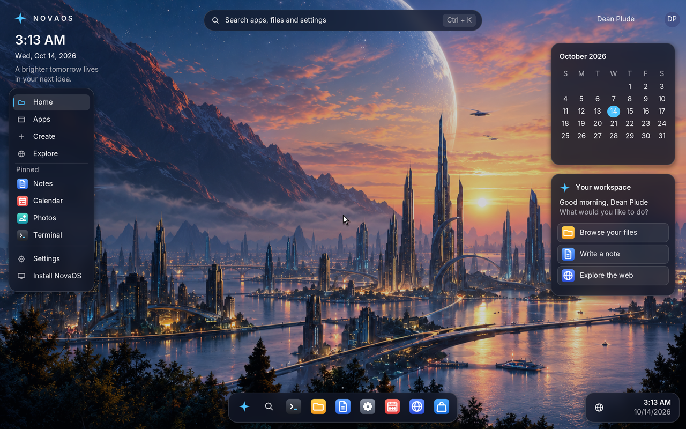
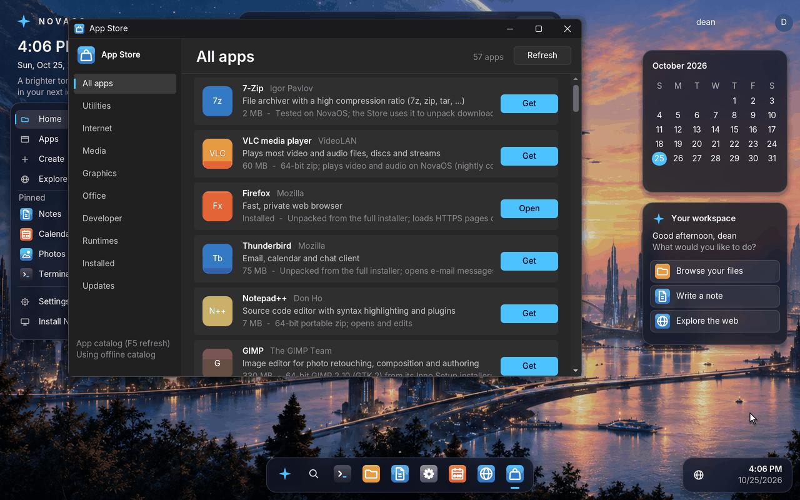

# NovaOS — Windows-Compatible Operating System
<!-- The regions between "BEGIN generated" and "END generated" markers are built from fragment files by tools/docgen.py: edit those files, not the regions (CONTRIBUTING.md). -->

A clean-room, from-scratch x86-64 operating system that runs native Windows
executables without emulation.  The programs' own machine code runs directly
on the CPU; NovaOS supplies what they expect from Windows: the NT system-call
ABI, the Win32 API, the loader, a GUI, and the drivers underneath.  64-bit
(x64, PE32+) programs run natively, and 32-bit (x86, PE32) ones run through
NovaOS's own WoW64 layer, as on 64-bit Windows.

**Status:** working towards the first release, 0.1 (Phase 22 of the
roadmap).  NovaOS boots on UEFI machines (tested in QEMU with OVMF; no
real PC has been checked yet, see [docs/hardware.md](docs/hardware.md)),
uses every CPU core, keeps its files on a SATA or NVMe disk, and runs
unmodified Windows programs: 7-Zip, Git, Notepad++, Firefox, VLC,
Audacity, KeePassXC, Inkscape, NSIS installers, `.msi` packages (with
their own dialogs, custom actions, shortcuts and services), the Java,
.NET, Node.js and Python runtimes, and OpenGL, Vulkan and Direct3D 8–11
programs through Mesa and DXVK.  It can install itself on a disk from its
live ISO.  New to NovaOS?  Start with the
[user guide](docs/user-guide.md); [docs/compatibility.md](docs/compatibility.md)
rates each program and game that has been tried, ProtonDB-style.

- [Screenshots](#screenshots)
- [What is inside](#what-is-inside)
- [Quick start](#quick-start)
- [Testing](#testing)
- [Roadmap](#roadmap)
- [Repository layout](#repository-layout)
- [Key design decisions](#key-design-decisions)
- [Documentation](#documentation)
- [License](#license)

## Screenshots

Captured from NovaOS running in QEMU at 2560×1600 (200% scale) and stored at
1280×800; [docs/screenshots/README.md](docs/screenshots/README.md) says how
each one was taken.

| | |
|---|---|
|  |  |
| The desktop: Terminal and File Explorer snapped side by side | Notepad++ 8.8 editing NovaOS's own kernel scheduler |
|  |  |
| The App Store, which installs real Windows programs | Firefox loading a page over HTTPS |
|  |  |
| VLC playing an H.264 video with sound | KeePassXC (Qt) with an open password database |
|  |  |
| Inkscape (GTK) with a new document | Beneath a Steel Sky (free on GOG) on ScummVM, installed with its installer |
|  |  |
| Teeworlds in full screen at its start menu, its music playing | Tyrian 2.1 (freeware) on OpenTyrian in full screen, drawn with Direct3D 9 through DXVK |
|  |  |
| Blobby Volley 2 in full screen: the display switched to 800x600, drawn with Direct3D 9 in exclusive full screen through DXVK | LBreakout2 (SDL 1.2) in full screen: the display switched to 640x480, drawn with GDI |
|  |  |
| Cave Story (freeware) in full screen: DirectDraw through cnc-ddraw, the display switched to 640x480 | SuperTux (SDL 1.2) played with an Xbox 360 game pad through winmm's joystick functions |

## What is inside

A short tour; [docs/inside.md](docs/inside.md) has the full one and
[docs/HISTORY.md](docs/HISTORY.md) the details of every part, phase by phase.

<!-- BEGIN generated:inside -->

- **Boot**: a UEFI bootloader loads the ELF kernel from the EFI System Partition or the ISO; the same ISO runs live and installs to a disk.
- **Kernel** (`kernel/`): an NT-style executive with objects and handles, processes and threads, virtual memory, an SMP scheduler and a registry.
- **Drivers**: SATA and NVMe disks, FAT, GPT and NTFS, USB (xHCI to UHCI, HID, mass storage), Intel and virtio networking, audio, ACPI and power.
- **Networking**: lwIP over IPv4 and IPv6, DNS, DHCP and SLAAC, TLS 1.3/1.2 on Mbed TLS, HTTP/2 and Winsock.
- **Windows userland** (`userland/`): about 35 system DLLs written from scratch, x64 and x86, with `ntdll`, `kernel32`, `user32`, `gdi32`, COM, the Windows Installer and a C runtime; text, 2D drawing, ICU and media support are part of it.
- **Program support**: the PE loader, x64 and x86 structured exceptions, WoW64, services, and the compatibility shims real programs need.
- **Updates and apps**: the App Store installs real Windows programs and, from a signed update channel, newer NovaOS builds; Firefox is bundled and Hyper-V is supported.

<!-- END generated:inside -->

## Quick start

Linux (Ubuntu/Debian) is the build host; on Windows use WSL2.

Install the prerequisites, build the bootloader, the kernel with the whole
userland inside, and `nova.img`, then run it in QEMU:

```bash
sudo apt install cmake nasm clang lld llvm libc++-dev gcc-mingw-w64-x86-64 \
                 python3 qemu-system-x86 ovmf mtools dosfstools xorriso
mkdir build && cd build
cmake ..
make -j$(nproc)
cmake --build . --target run
```

The first build compiles the NetSurf browser (about 800 files; later builds
reuse the objects).  Set `NOVA_NO_NETSURF=1` to leave the browser out, and
`NOVA_NO_WOW64=1` to skip the 32-bit userland.  `run` attaches a second
disk, `build/nova-data.img`, where drive C: is kept across restarts and
rebuilds.  [docs/building.md](docs/building.md) covers the build, QEMU
options, putting your own programs on the disk, and debugging.

### Bootable ISO and installing on a disk

A ready-to-boot UEFI ISO, `nova.iso`, is built by CI rather than committed.
Download it from the [newest release](https://github.com/dean-plude/os/releases/latest)
with its checksum (`sha256sum -c nova.iso.sha256`), take the one built
from `main` from the [`latest` build](https://github.com/dean-plude/os/releases/download/latest/nova.iso),
or the `nova-iso` artifact of any pull request's CI run (the
**Artifacts** list on the run's Summary page).  It is also the installation disc: booted from it, NovaOS runs live and
opens **Install NovaOS**, which writes a GPT disk with an EFI System
Partition and a data partition for drive C:.

```bash
truncate -s 1G disk.img
cp /usr/share/OVMF/OVMF_VARS_4M.fd /tmp/OVMF_VARS.fd
qemu-system-x86_64 -machine q35 -m 2G -smp 4 \
  -drive if=pflash,format=raw,unit=0,readonly=on,file=/usr/share/OVMF/OVMF_CODE_4M.fd \
  -drive if=pflash,format=raw,unit=1,file=/tmp/OVMF_VARS.fd \
  -drive file=disk.img,format=raw -cdrom nova.iso
```

After installing, the same command without `-cdrom nova.iso` starts from
`disk.img`.  The first start from it opens **Welcome to NovaOS**, which
asks for your name, your time zone, your keyboard layout and a display
resolution before the desktop (`start welcome` in the Terminal goes through it again).

Give the machine 2 GB so downloaded installers fit in drive C: (which lives
in memory and is saved to disk).  On macOS with Homebrew QEMU, the firmware
ships with QEMU:

```bash
FW="$(brew --prefix qemu)/share/qemu/edk2-x86_64-code.fd"
qemu-system-x86_64 -machine q35 -m 2G -smp 4 \
  -drive if=pflash,format=raw,readonly=on,file="$FW" \
  -cdrom nova.iso -serial stdio
```

The same ISO starts a real PC from a USB stick (UEFI, Secure Boot off;
the display is the firmware's framebuffer).  Writing it erases the stick:
on Linux, find the stick with `lsblk` (here `/dev/sdX`) and run the
commands below; on Windows use Rufus in "DD image" mode or balenaEtcher,
and on a Mac see [docs/macos.md](docs/macos.md).  Started from the stick,
NovaOS runs live as from the disc and writes its log into
`EFI\NOVA\bootlog.txt` on the stick's EFI partition (partition 2,
labelled `NOVA_EFI`), so a PC without a serial port still leaves a log to
read on another computer.  Linux mounts that partition as it is; macOS
with `diskutil mount` (`disk4s2` for a stick at `disk4`); Windows gives
an EFI partition no drive letter by itself, so assign one in `diskpart`
(`list volume`, `select volume N`, `assign letter=Z`).

```bash
sudo dd if=nova.iso of=/dev/sdX bs=4M conv=fsync status=progress
sync
```

To make the ISO yourself from a fresh build, run
`scripts/create-iso.sh nova.iso build/bootx64.efi build/kernel.elf`
(needs `xorriso`).  `*.iso` is in `.gitignore`: the ISO is never committed.

## Testing

**Every pull request is boot-tested.**  GitHub Actions builds the kernel,
bootloader, userland and `build/nova.img`, boots it in QEMU with OVMF and
runs the core, network and graphics suites with `tools/selftest.py`; a
failing test fails its check.  It also times the boot, Firefox's start and `smpstress`
scaling and fails on a large regression (the performance budget).  **Every night**, `tools/appcorpus.py` runs the
official Windows releases of ripgrep, 7-Zip, Python, .NET, Firefox, VLC,
Notepad++, Krita, games and many more, each one's screenshot compared with
a reference.  A push to `main` that passes publishes the `latest` ISO.

The full list of tests and programs, what the suites run, and how to use
the serial log, `trace` and crash reports: [docs/testing.md](docs/testing.md).
How CI is organised: [docs/ci.md](docs/ci.md).  Running the tests yourself:
[docs/building.md#tests](docs/building.md#tests).

## Roadmap

**Current status: Phase 22, preparing the first release (0.1).** UEFI boot,
the x64/x86 Windows environment, desktop, persistent storage, tested apps,
software graphics and QEMU virtio-GPU acceleration are in place. The app
corpus and QEMU checks provide evidence for these features; they do not imply
broad Windows compatibility or native physical-GPU support.

The 0.1 release is not complete until its ISO boots on the reference ThinkPad
T14 Gen 4 and the release is tagged. Real-hardware validation remains
outstanding.

| Next phase | Focus |
|---|---|
| 23 | Finish 0.1: check the T14, fix its first missing driver, achieve a clean nightly week, check Hyper-V input and verify update signing. |
| 24 | Gaming: Steam/GOG sign-in and a DRM-free game; Direct3D 12 support is already demonstrated. |
| 25 | GPU: design and implement native Intel GPU support, then test 3D and an external monitor; retain the CPU fallback. |
| 26 | Kernel, console and storage: complete console cells and ConPTY, verify NTFS after power loss, and track performance regressions. |
| 27 | Everyday apps: grow the nightly App Store corpus, add office-suite coverage and verify public HTTPS browsing. |
| 28 | Laptop hardware: Wi-Fi, Bluetooth, camera, battery life and a second reference PC. |
| 29 | NovaOS 0.2 release on both reference PCs. |

See the [full roadmap](docs/ROADMAP.md) for current evidence, remaining
milestones and completion gates.

## Repository layout

```
os/
├── bootloader/           # UEFI bootloader (PE32+ EFI application)
├── include/              # Headers shared by bootloader and kernel (boot_protocol.h)
├── kernel/               # NT-style kernel (freestanding ELF64)
│   ├── arch/x86_64/      # GDT, IDT, APIC, paging, SMP trampoline, syscall entry
│   ├── ke/               # Startup, scheduler, SMP, wait queues, KPCR, syscall table, time zones
│   ├── mm/               # Physical pages, kernel heap, VMAs, sections
│   ├── ob/ ps/ se/ cm/ io/  # Object, process, security, configuration, I/O managers
│   ├── um/               # Windows programs: processes, threads, loader, NT services,
│   │                     #   WoW64, pipes, registry, sockets, windows, consoles
│   ├── fs/               # VFS, RAM disk (drive C:), FAT16/32, saving C:, Setup engine
│   ├── drivers/          # AHCI (SATA), NVMe, e1000/e1000e/I219, virtio-net, USB core, xHCI/EHCI/OHCI/UHCI, hubs, HID, mass storage
│   ├── hal/              # Serial, framebuffer, display (VBE), PCI, PS/2, CMOS clock, HPET, I/O APIC, ACPI (uACPI host)
│   ├── net/              # lwIP port, HTTP client, TLS (Mbed TLS)
│   ├── gdi/              # Software renderer, fonts, ICO and PNG decoding
│   ├── wm/               # Window manager, desktop shell, input, keyboard layouts, clipboard
│   ├── apps/             # Built-in apps: Terminal, Explorer, Notepad, Settings,
│   │                     #   Calendar, Photos, App Store, Setup
│   ├── ldr/              # Early PE loader and syscall thunk pages
│   └── lib/              # Freestanding string and memory library
├── userland/             # The Windows userland, built with clang + lld-link:
│   ├── ntdll/ kernel32/ user32/ gdi32/ ...   # one directory per system DLL (dll.json)
│   ├── msvcrt/ crt/      # C runtime (msvcrt.dll and ucrtbase.dll), program startup
│   ├── msi/              # Windows Installer (msi.dll)
│   ├── programs/         # cmd.exe, msiexec, reg, find..., samples and self-tests
│   ├── netsurf/          # NetSurf port: fetcher, window surface, fonts
│   └── include/          # The Windows SDK headers NovaOS provides
├── third_party/          # lwIP, Mbed TLS, nghttp2, libxml2, uACPI, musl (libm), HarfBuzz, FreeType, NetSurf, stb, fonts, ICU (icu.dll + data), 7-Zip installer
├── tools/                # Host tools: build_userland.py, build_netsurf.py, mkfont,
│                         #   make_icons.py, mkani.py, pe_imports.py, msitest/, docgen.py,
│                         #   mkupdate.py and release_notes.py (releases)
├── tests/                # CI self-tests and app corpus (one file per test), ACPI
│                         #   tables, reference screenshots
├── scripts/              # build.sh, run-qemu.sh, create-disk.sh, create-iso.sh
└── docs/                 # Building, releasing, roadmap, feature history, Phase 1 architecture,
                          #   release notes (releases/), and the fragments README and docs/*.md are built from
```

## Key design decisions

The full list, with the reasons, is in
[docs/design/architecture.md](docs/design/architecture.md).

- **Clean-room and ABI-faithful**: every DLL and service is written from
  scratch, but syscall numbers, `NTSTATUS` codes and structure layouts
  follow Windows 10 1903 x64, so unmodified binaries find what they expect.
- **Native execution, both bitnesses**: x64 in long mode, x86 in compatibility
  mode through a 32-bit `ntdll`, the way WoW64 does.
- **The window system lives in the program**: `user32` keeps the window tree;
  the kernel composites top-level windows from bitmaps the programs own.
- **Software rendering**: GDI is a CPU rasterizer at integer HiDPI scale;
  the QEMU 3D virtio-gpu (Venus, virgl) is the only GPU path so far.
- **Drive C: in memory, saved to FAT**, with its files read back on demand.
- **SMP with fine-grained locks**, and a big lock for the rest of the kernel.
- **Kernel-helper syscalls (0x01F0–0x01FF)** are private to NovaOS's own DLLs.

## Documentation

- [docs/user-guide.md](docs/user-guide.md): using NovaOS: trying it in a
  virtual machine, installing it, the desktop and its apps, installing
  programs.
- [docs/compatibility.md](docs/compatibility.md): which Windows programs
  run, rated Platinum to Borked as ProtonDB does, and how each was checked.
- [CONTRIBUTING.md](CONTRIBUTING.md): where a change goes (one file per
  DLL, test and doc item, so parallel pull requests do not conflict) and
  how to merge main into a branch.
- [docs/building.md](docs/building.md): building, running, the data disk,
  tests, debugging.
- [docs/ci.md](docs/ci.md): how CI is organised, and what its network and
  graphics suites run.
- [docs/design/architecture.md](docs/design/architecture.md): the key design
  decisions in full.
- [docs/macos.md](docs/macos.md): running and building on a Mac (Apple
  Silicon and Intel).
- [docs/ROADMAP.md](docs/ROADMAP.md): the compatibility strategy and what
  comes next.
- [docs/hardware.md](docs/hardware.md): the reference PC for real
  hardware, which of its devices NovaOS drives, and every driver NovaOS
  has.
- [docs/drivers.md](docs/drivers.md): the default driver and firmware
  set (firmware downloaded from linux-firmware), Windows kernel drivers
  as services, and the driver signing policy (Microsoft-signed, or
  test-signed with test signing on).
- [docs/design/windows-drivers.md](docs/design/windows-drivers.md): the
  plan to run Windows driver packages the way Windows 11 does (NT
  kernel-mode driver interface, KMDF/UMDF, download by hardware ID).
- [docs/design/intel-gpu.md](docs/design/intel-gpu.md): the plan for the
  reference laptop's Intel Iris Xe (Intel's Windows driver through a WDDM
  host, its Vulkan driver under DXVK and VKD3D-Proton).
- [docs/hyperv.md](docs/hyperv.md): running NovaOS in a Hyper-V VM (the
  keyboard and mouse over VMBus) and what does not work there yet.
- [docs/ethernet.md](docs/ethernet.md): the Intel Ethernet driver, the
  I219 IDs it takes and how it brings one up.
- [docs/install-and-power.md](docs/install-and-power.md): installing on a
  laptop's NVMe disk, its embedded controller, sleep without S3, and the
  checks to run on the reference ThinkPad.
- [docs/HISTORY.md](docs/HISTORY.md): what every phase added, in detail.
- [docs/phase1-architecture.md](docs/phase1-architecture.md): the boot flow,
  address-space layout and early kernel design.

## License

NovaOS is MIT licensed. The operating system (kernel, bootloader, system
DLLs, C runtime, desktop and apps) contains no GPL code (the one LGPL
library, the HLSL compiler in `d3dcompiler_47.dll`, is below); bundled third-party
code keeps its own permissive licence (<!-- BEGIN generated:licenses -->lwIP: BSD 3-clause; Mbed TLS: Apache-2.0; Monocypher: BSD-2-Clause (or CC0); nghttp2: MIT; libxml2: MIT; mujs: ISC; uACPI: MIT; Intel's e1000 shared code (FreeBSD's, for the I219 bring-up in `kernel/drivers/e1000.c`): BSD 3-clause; OpenBSD's `pchgpio(4)` (Intel GPIO controllers' register layout and pad groups, in `kernel/hal/gpio.c`): ISC; musl's libm and complex functions: MIT; ICU: Unicode License v3 (`third_party/icu/LICENSE`); kernel32's locale table, from .NET: MIT; the time zone table (`kernel/ke/tzdata.inc`): zone names from Unicode CLDR's windowsZones, Unicode License v3; rules from the IANA tz database, public domain; HarfBuzz: MIT; the keyboard layouts (`userland/include/kbdlayouts.h`): xkeyboard-config, MIT/X11 licence, compiled by libxkbcommon (MIT); FreeType: the FreeType License (BSD-style; portions of this software are copyright © 2024 The FreeType Project (www.freetype.org), all rights reserved); Boost.Math (the C++17 special math functions in `msvcp140_2.dll`): Boost Software License 1.0; Microsoft's C++ standard library (STL): Apache-2.0 WITH LLVM-exception; plutovg: MIT (with FreeType-licensed rasteriser and stroker files); Mesa's llvmpipe (mesa-dist-win 24.2.4, the built-in OpenGL): MIT; Mesa's Venus and virgl (`third_party/mesa-venus`, the App Store's Venus): MIT; the SPIR-V headers (`third_party/spirv-headers`, for the HLSL compiler in `d3dcompiler_47.dll`): MIT; Inter and Cascadia Mono: SIL OFL 1.1; Noto Sans Arabic and Devanagari: SIL OFL 1.1; DejaVu Sans Mono: Bitstream Vera licence; stb_truetype/stb_image: public domain or MIT; FAudio: zlib; TinySoundFont: MIT; Sound Open Firmware (Intel's signed audio DSP firmware, built in only when tools/fetch_sof_firmware.py fetched it): BSD 3-clause with Intel's firmware licence; cnc-ddraw (`third_party/cnc-ddraw`, `ddraw.dll`): MIT, with lodepng: zlib; The default firmware set (`tools/firmware.json`, files from linux-firmware for Intel graphics and Intel and Qualcomm Wi-Fi and Bluetooth, built in only when tools/fetch_firmware.py fetched them): redistributable unchanged under each vendor's licence (`LICENSE.i915`, `LICENCE.iwlwifi_firmware`, `LICENCE.ibt_firmware`, `LICENSE.QualcommAtheros_ath10k` with `NOTICE.qca`), kept beside the files in `C:\Windows\Firmware\LICENSES`; Firefox: Mozilla Public License 2.0 and bundled third-party notices (unmodified official Mozilla payload).<!-- END generated:licenses -->).  All Win32 API implementations are clean-room, based on public
Microsoft documentation, the ReactOS reference and study of Wine's source,
but independently written.

**NetSurf** (`third_party/netsurf/netsurf`) is licensed under the **GNU GPL
version 2**; its libraries are MIT, zlib and libpng licensed (see
`third_party/netsurf/NOVA-VENDOR.txt`).  `netsurf.exe`, NetSurf linked with
the NovaOS glue in `userland/netsurf` (MIT, GPL-compatible), is a separate
program distributed under the GPL-2.0, with its complete source in this
repository; the kernel image merely carries it as a file for drive C:.
Build with `NOVA_NO_NETSURF=1` for an image without it.

**vkd3d-shader** (`third_party/vkd3d-shader`), Wine's HLSL compiler, is
licensed under the **GNU LGPL version 2.1** (or later).  It is compiled
into `d3dcompiler_47.dll` alone, a separate DLL whose own sources
(`userland/d3dcompiler_47`, MIT) call it only through its public API; its
complete source is in this repository, with NovaOS's changes to it
(shader model 5.1 descriptor arrays, RWByteAddressBuffer's Load,
GetDimensions and Interlocked methods and stores to indexed groupshared
arrays, which wgpu's Direct3D 12 shaders use),
and a changed copy can be rebuilt into that DLL and put in its place (see
`third_party/vkd3d-shader/NOVA-VENDOR.txt`).

**7-Zip** (`third_party/7z2603-x64.exe`) is Igor Pavlov's unmodified
installer, kept as a test case under 7-Zip's own licence
(<https://www.7-zip.org/license.txt>); it is not part of NovaOS.
