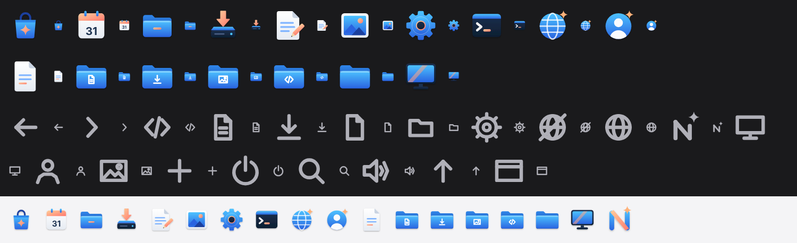
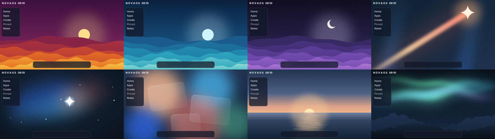

# NovaOS brand

The NovaOS logo, icon set, wallpapers and colour tokens, and the rules for
using them.  This is the design direction for the desktop: the wallpapers
ship in `C:\Pictures`, but the kernel still draws the older flat app tiles,
the four-pointed star and the letter-spaced "N O V A O S" wordmark
(`kernel/apps/apps.c`, `kernel/wm/aurora_workspace.h`) until they are redrawn
natively.

## Logo

The logo is **Beam**: an N whose two rounded pillars run from cyan to blue
and whose diagonal is a beam of dawn light, peach to coral, ending in a
four-pointed star at the top right.

| File | Use |
|---|---|
| [`logo/nova-mark.svg`](logo/nova-mark.svg) | The mark alone: app icon, favicon, boot screen, anywhere the name is already shown.  It holds up down to 16 px. |
| [`logo/nova-lockup-dark.svg`](logo/nova-lockup-dark.svg) | Mark and wordmark on dark backgrounds: "Nova" in `shell-text`, "OS" in `accent`. |
| [`logo/nova-lockup-light.svg`](logo/nova-lockup-light.svg) | The same on light backgrounds: "OS" in `brand-blue-bottom`, since `accent` is too faint on white. |

- The wordmark is Inter Bold, converted to outlines so it renders the same
  without the font installed.
- The mark always sits to the left of the wordmark, never above it.
- Keep clear space of at least half the mark's width around the logo.
- Do not recolour the pillars or the beam, put the mark on a tile, or
  separate the star from the N.
- In running text, write "NovaOS".

## Colour

[`tokens.json`](tokens.json) holds every colour, type style, spacing, radius,
size, blur and shadow value.  The interface values (`shell-*`, `ui-*`,
`pop-*`, `glass-*`, `accent`, the title bar colours) are the ones in
`kernel/wm/desktop.c`, `kernel/apps/apps.h` and `kernel/wm/wm.c`.  The brand
colours come from the logo:

| Token | Value | From the logo | Used for |
|---|---|---|---|
| `brand-blue-top` → `brand-blue-bottom` | `#4cc2ff` → `#2a64e0` | the pillars | bodies of icons: folders, globes, cogs, screens |
| `brand-blue-deep` | `#1c3f9e` | | the shade side of blue objects |
| `brand-dawn-top` → `brand-dawn-bottom` | `#ffce9b` → `#ff7a6e` | the beam | the one accent per icon |
| `brand-spark` | `#ffb27a` | the star | the spark on the web and welcome icons |
| `brand-navy-top` → `brand-navy-bottom` | `#1d304f` → `#0d1e31` | | dark objects: the terminal, the drive, the monitor |

Brand colours are for the logo, icons and wallpapers.  The interface chrome
keeps its neutrals, its glass and the single `accent`.

## Icons

Every icon is drawn on a 100-unit grid.

- **App icons** ([`icons/apps/`](icons/apps)) are free-standing objects, not
  tiles.  Each has a blue body, one dawn accent marking what the app does,
  navy or white-paper secondary parts, and one soft drop shadow (offset 2.5,
  blur 2.4, black at 28%).  The icons are Terminal, File Explorer, Notepad,
  Settings, Calendar, the web globe (Firefox and NetSurf), Photos, App Store,
  Install NovaOS and Welcome.  Objects fill about 80% of the square.
- **File icons** ([`icons/files/`](icons/files)) follow the same rules:
  - Folders are blue, and the Documents, Downloads, Pictures and Projects
    folders carry their glyph in white.
  - Pages are white with blue lines and one dawn line.
  - This PC is a navy monitor with a dawn beam across its blue screen.
- **Glyphs** ([`icons/glyphs/`](icons/glyphs)) are one-colour line drawings
  for sidebars, toolbars, the dock and the tray.
  - Lines are `icon-stroke` (10% of the size) with round caps and joins, the
    weight of the logo's pillars.
  - `nova.svg` is the logo in one ink.
  - The files are drawn in `shell-text-2`.  In the shell, glyphs take
    `shell-text` on glass, `shell-text-2` when idle and `accent` when
    selected.
- Sizes in the shell:

  | Where | Size |
  |---|---|
  | Dock (`dock-icon`) | 28 px |
  | Sidebar | 20 px |
  | Workspace shortcuts | 24 px |
  | Dialogs | 48 px |

- Third-party programs show their own `.ico`.  A program without one gets a
  `program-tint-*` tile with its initial.  NovaOS never draws other
  companies' logos.

## Wallpapers

All are 2560 x 1440 PNGs in `userland/samples/`, so they are installed in
`C:\Pictures`:

| File | Scene |
|---|---|
| `Aurora-Sunrise.png` | The default Aurora wallpaper (unchanged) |
| `Beam.png` | The logo as a night scene: navy sky, faint blue pillars of light, a dawn beam rising to a bright star |
| `Nova-Night.png` | A starfield with blue, cyan and peach nebulae around one bright star |
| `Horizon.png` | A calm dawn over still water, the sun on the horizon and its reflection |
| `Glass-Dawn.png` | Soft fields of dawn, cyan, coral, blue and green behind three frosted panes |
| `Aurora-Lights.png` | Green and cyan northern lights over two navy ridges |
| `Sunset-Waves.png`, `Ocean-Waves.png`, `Twilight-Waves.png` | The Sunset, Ocean and Twilight themes as six rolling hills in their `wall-<theme>-*` colours |

Every wallpaper keeps its busiest detail away from the top-left, where the
sidebar sits, and from the bottom, where the dock sits.  Glass panels and
white text stay readable on all of them.  Keep it that way for any new
wallpaper.

## Type, space and voice

- **Type:** Inter, in three styles:
  - `body`: 13 px Regular on a 16 px line.
  - `body-strong`: 13 px SemiBold.
  - `display`: 24 px SemiBold.

  Cascadia Mono 13 px is used in Terminal and Notepad.
- **Corners:**

  | Element | Token | Radius |
  |---|---|---|
  | Buttons | `radius-control` | 6 px |
  | Rows and windows | `radius-row` | 8 px |
  | Glass panels | `radius-glass` | 16 px |
  | The search bar | `radius-search` | 20 px |

- **Rows:** 30 px tall, spaced 32 px apart (`row-step`).
- **Voice:**
  - Write in sentence case.
  - Address the user as "you".
  - Say what a thing does: "Explore the web", not "Web Browser".
  - No emoji.
  - Never show invented data.
