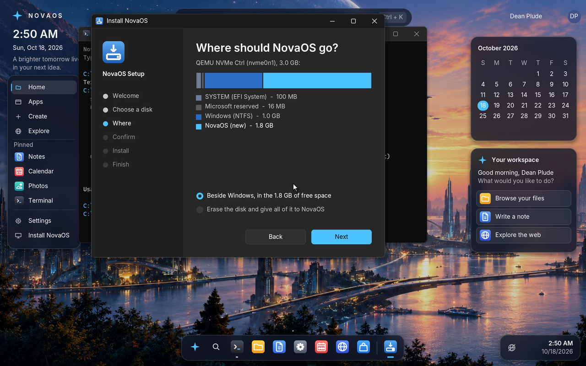
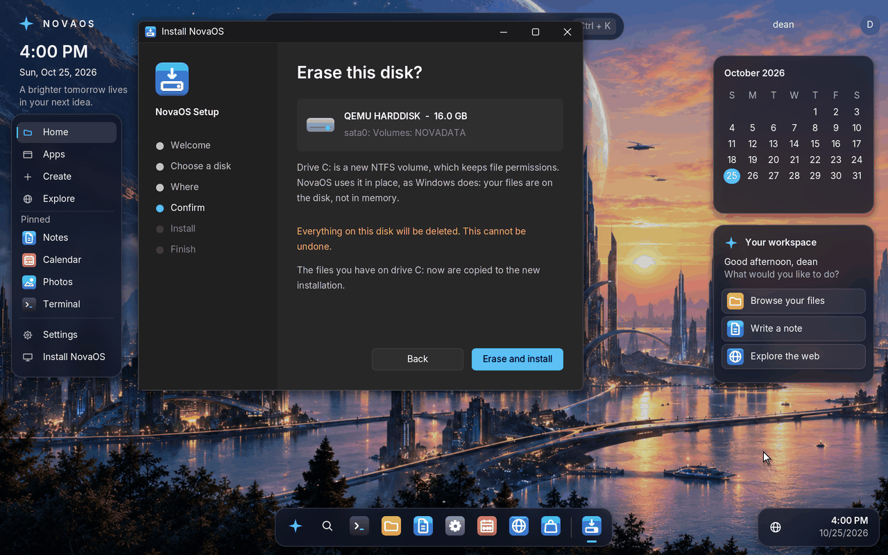
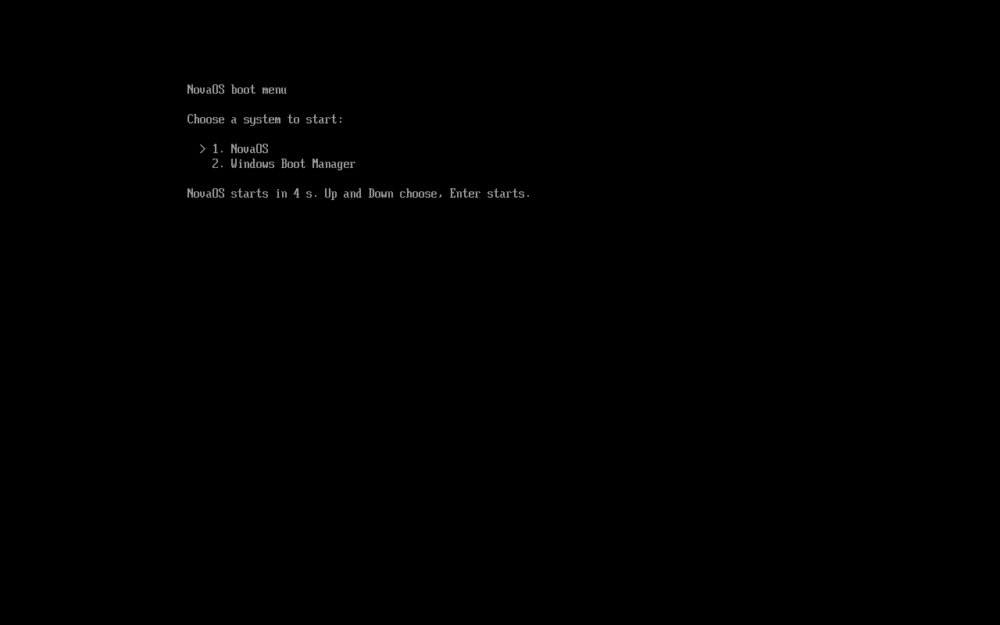
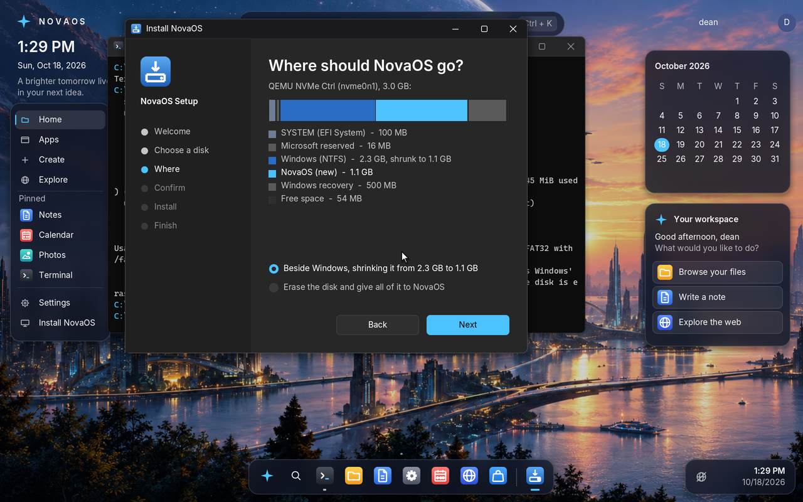
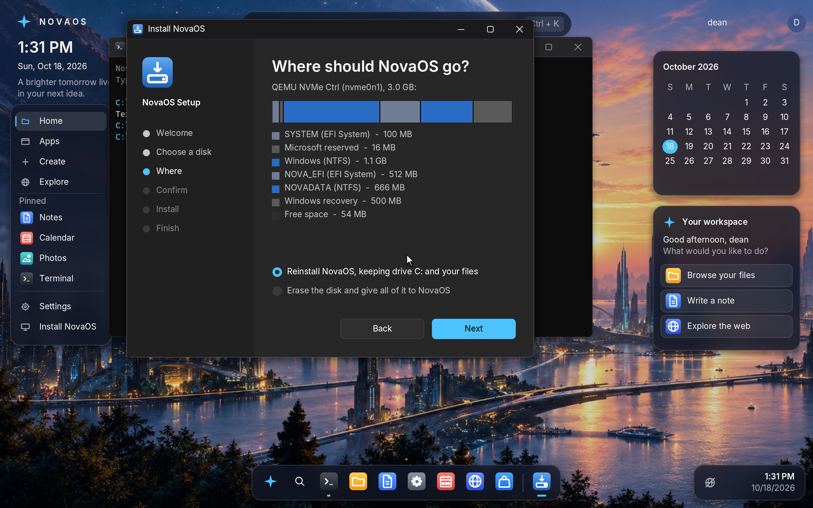

# The installer beside Windows (roadmap step 33.4)

How NovaOS's Setup installs NovaOS on a PC that already has Windows,
without touching the Windows install, the way Windows Setup and the
installers of other systems that dual-boot with Windows do it. How a
whole disk is installed, the firmware boot entry and the T14 notes are in
[install-and-power.md](../install-and-power.md); the boot menu and the
recovery boot belong to step 33.3 ([recovery.md](recovery.md)).

| Windows Setup | NovaOS Setup |
|---|---|
| "Where do you want to install Windows?": each disk's partitions and unallocated space | "Where should NovaOS go?": the disk's partitions and free space drawn as a map, with what NovaOS would take |
| Installs into unallocated space, keeping the other partitions | "Beside Windows": NovaOS's partitions in the largest free space, every other partition kept |
| Shares the disk's ESP, adds its files under `\EFI\Microsoft` | An ESP of its own, `NOVA_EFI` (see below) |
| Adds "Windows Boot Manager" to the firmware's boot entries | Adds "NovaOS" to them, first in `BootOrder`, Windows' entry kept after it |
| Boot Manager lists the other systems | NovaOS's boot menu lists "Windows Boot Manager" and starts it |

## Done (part 1): installing into the free space

`SetupListDisks` (`kernel/fs/setup.c`) reads each disk's partition table
(`DiskReadLayout`, `kernel/fs/partition.c`), names each partition from its
volume (`"Windows (NTFS)"`, `"SYSTEM (EFI System)"`) or its GPT type
(`"Microsoft reserved"`, `"Windows recovery"`), finds the free spaces
between them on 1 MiB boundaries, and says whether NovaOS fits beside them:
a GPT disk with enough free space (`SetupBesideBytes`: an ESP sized for
the system twice and the boot files, about 600 MB today, plus 512 MiB for
drive C:), that NovaOS is not already on
and is not running from. A Windows disk is one with a Microsoft reserved
partition or `\EFI\Microsoft\Boot\bootmgfw.efi` on an ESP.

Setup's window (`kernel/apps/setup.c`) has a page between choosing the
disk and confirming: "Where should NovaOS go?", with the disk's partitions
as a bar to scale and a line for each, NovaOS drawn in the free space it
would take, and two choices, "Beside Windows, in the X GB of free space"
(chosen when it fits) and "Erase the disk and give all of it to NovaOS".
The Terminal's `install <disk> /beside` does the same.

Installing beside the other systems:

1. The disk's GPT is read again and NovaOS's two partitions are added in
   its largest free space, in the first unused entries: an EFI System
   Partition (FAT32 `NOVA_EFI`, sized as for a whole disk: the system, a
   staged update and the boot files) and a basic data partition
   (`NOVADATA`, NTFS) for drive C: with the rest, at least
   512 MiB. Every partition already there keeps its entry number, place,
   type, GUIDs, attributes and name, so Windows' Boot Manager (which finds
   its partitions by GUID and offset) is not affected.
2. Only the first sectors of the two new partitions are cleared; the
   table is written with the backup copy at the end of the disk
   (`DiskWriteLayout`). Nothing of the other partitions is read or written.
3. The rest is the whole-disk installation: format, copy the boot loader,
   kernel and boot files, format drive C:, copy this session's files.
4. The disk's other volumes are mounted again (Windows' NTFS volume as a
   drive letter, as it was in the live session).

**Why an ESP of its own.** Windows Setup makes a 100 MB ESP (260 MB on
4K-sector disks). NovaOS's boot files are larger than that once a staged
update is counted, and an update writes to the ESP while Windows is
installed beside it. The UEFI specification allows several ESPs on a disk
and firmware searches each one; Windows only uses the ESP its own boot entry points at.
So Windows' ESP is never written, and removing NovaOS later is deleting
two partitions.

**The test.** The devices suite's `beside` boot
(`tests/selftest/devices/beside`) builds the disk of a PC with Windows
from the host (`windows_disk` in `tools/selftest.py`: ESP `SYSTEM` with a
stand-in `bootmgfw.efi`, a Microsoft reserved partition, an NTFS volume
`Windows` with a file, and 1.9 GiB free on a 3 GiB NVMe disk), starts
nova.iso from a USB stick, drives Setup's window from the keyboard
(a screenshot of each page in the work directory), starts NovaOS from the
disk and reads Windows' file from its drive letter. Once QEMU has quit the
host checks the GPT (Windows' three partitions where they were, NovaOS's
ESP and data partition in the free space), compares Windows' reserved
partition and each file on its ESP with their hashes from before, and
checks the NTFS volume with `scripts/ntfs-check.py` and `ntfscat`. (The
ESP is compared file by file because QEMU's firmware, with no flash store
for its variables, writes them to `NvVars` on the first ESP it finds; a
PC's firmware does not.)

The test found that NovaOS itself wrote to every FAT volume it only
looked at: unmounting rewrote the FAT32 FSInfo sector, with the free
cluster count "unknown". `FatSync` (`kernel/fs/fat.c`) now updates FSInfo
only on a volume something was written to, so listing the disks in Setup
leaves Windows' ESP as it was.

## Done (part 2): the firmware's boot entry and the boot menu

**The firmware boot entry from Setup.** A real PC already has "Windows
Boot Manager" first in `BootOrder`, so NovaOS's ESP alone would not be
started. As the last step of an installation (beside Windows or on the
whole disk) Setup calls the firmware's runtime services, `GetVariable` and
`SetVariable` (`kernel/hal/efi.c`, as Windows'
`SetFirmwareEnvironmentVariable` and `bcdedit /set {fwbootmgr}` do): it
writes `Boot####` "NovaOS" for `\EFI\BOOT\BOOTX64.EFI` on `NOVA_EFI`
(reusing the entry that already names that partition on a reinstall, else
the first free number) and puts it first in `BootOrder` with every other
entry after it, Windows' included. The entry's path is the short form
`HD(entry, GPT, unique GUID, start, size)/\EFI\BOOT\BOOTX64.EFI`, which
firmware expands to the disk wherever it is attached (UEFI 2.10, 3.1.2);
the boot loader's own check for its entry (`ensure_boot_entry`,
`bootloader/src/main.c`) accepts that form as well as its full one, so
the first start from the disk finds Setup's entry instead of adding a
second.

How the kernel calls the runtime services: the boot loader hands over the
firmware's `EFI_RUNTIME_SERVICES` table (boot protocol 6). NovaOS never
calls `SetVirtualAddressMap`, so the services run in physical mode, as the
specification allows: for each call the kernel switches to page tables that
map the first 4 GiB and every runtime or MMIO region the firmware listed
one to one (2 MiB pages, built on the first call) and its own half of the
address space as it is, with interrupts off, one CPU at a time, and the
caller's x87/SSE/AVX state saved around the call (the firmware is free to
use SSE). A firmware that refuses the variable leaves the old behaviour:
the boot loader adds its entry on the first start from the disk, through
the firmware's boot menu (F12 on a ThinkPad).

**Windows in NovaOS's boot menu.** On an installed disk the boot loader
(`bootloader/src/bootmenu.c`) looks on every other volume the firmware can
read for `\EFI\Microsoft\Boot\bootmgfw.efi`. When it finds one it shows
the boot menu before anything else (the update and rollback choice comes
after it): "1. NovaOS" and "2. Windows Boot Manager", with "NovaOS starts
in 5 s"; Up, Down or a line's number choose and stop the countdown, Enter
starts. Windows' boot manager is started as the firmware's boot manager
would start an entry: `LoadImage` from its volume's device path and file,
the firmware's watchdog armed, `StartImage`. If it returns (or cannot be
loaded) the menu shows again. One "Windows Boot Manager" line is enough:
it lists every Windows itself. Step 33.3's recovery choices (previous
version, safe mode, startup repair) are a menu of their own that follows
it, Advanced startup ([recovery.md](recovery.md)).

**The test.** The `beside` boot's stand-in `bootmgfw.efi` is a small UEFI
application (`bootmgfw_standin` in `tools/selftest.py`, a PE32+ the host
writes byte by byte) that prints a line on the firmware's console and
returns. After Setup the log must show its `Added the firmware boot entry
Boot#### "NovaOS" for nvme0n1, first in BootOrder` (read back after
writing); the first start from the disk must say `The firmware has a
"NovaOS" boot entry for this disk` (Setup's entry kept by the firmware
across the restart, and recognised); then a restart through the boot menu
(screenshot `boot-menu.png`) chooses Windows Boot Manager, the stand-in's
line appears, the menu comes back, and NovaOS is chosen and starts. QEMU's
firmware copies its console to the serial port, where the test reads the
menu. The `laptop` boot checks the same boot entry after a whole-disk
install.

## Done (part 3): making room, and reinstalling with the data kept

**Shrinking Windows' volume.** Most PCs sold with Windows have no free
space: Windows' volume runs up to its recovery partition. When a GPT disk
has too little free space, `SetupListDisks` mounts each NTFS basic data
partition read-only and asks `NtfsShrinkLimit` (`kernel/fs/ntfs.c`) how
small it could get: not at all if Windows did not leave it clean (a
transaction waiting in `$LogFile`, a chkdsk pending, hibernated or Fast
Startup, the checks NovaOS already makes before writing to a Windows
volume), else what its files use plus 10% and 256 MiB, and never below the
end of `$MFT`'s data, which can't move (Windows' own "Shrink Volume" can't
move it either). NovaOS gets half the volume's free space, at least what
it needs and at most 64 GiB, taken from the volume's end, so the free
space after it grows; the Where page offers "Beside Windows, shrinking it
from X to Y", draws Windows smaller and NovaOS in the room, and the
Terminal's `install <disk> /shrink` does the same.

How `NtfsShrink` shrinks a volume (what ntfsresize and Windows do; it is
written from the on-disk format, ntfsresize being GPL, and no MIT, BSD or
zlib NTFS resizer was found):

1. Every MFT record in use is read and checked first; any it can't read,
   or data past the new end that won't fit below it, and nothing is
   written.
2. `$Volume` is marked dirty.
3. For each MFT record, each non-resident attribute piece (an attribute in
   several records through an `$ATTRIBUTE_LIST` has a piece, with its own
   mapping pairs, in each) whose runs reach past the new end: new clusters
   below the end are taken from `$Bitmap`, the data copied there, and the
   piece's mapping pairs rewritten (a run cut at the end keeps its part
   below it), then the record is written (and `$MFTMirr` for records 0-3).
   `$MFTMirr` itself, `$LogFile`, `$Bitmap`, the MFT's own bitmap, index
   blocks and files all move this way; `$BadClus`'s `$Bad` is cut, not
   moved.
4. `$Bitmap` is written with nothing in use past the new end (a valid
   volume of the old size still), then the boot sector with the new
   sector count (and `$MFTMirr`'s cluster), and its backup in the new
   last sector of the partition, then `$Bad` and `$Bitmap` are cut to the
   new size (`$Bitmap`'s bits past the end set, as Windows and mkntfs
   leave them).
5. Setup makes the GPT entry smaller (`DiskWriteLayout`), keeping its
   place, GUIDs, type and name, and installs beside it as in part 1.

The volume is left marked dirty, so the next system to mount it checks it:
Windows' autochk, or NovaOS's own check (`repair()`, which mounting it as a
drive letter runs; on a sound shrink it reports nothing to put right). A
shrink cut off part way (the power goes) leaves a volume that mounts at
the old size or the new one with every file whole. Encrypted (BitLocker)
volumes are not NTFS to NovaOS and are not offered.

**Reinstalling keeps the data.** On a disk NovaOS is on (not the one it is
running from), the Where page offers "Reinstall NovaOS, keeping drive C:
and your files" and `install <disk> /reinstall` does the same: Setup finds
`NOVA_EFI` and `NOVADATA` in the disk's GPT, checks the ESP is big enough
for this version (else it says to erase instead), formats only the ESP
again and copies the boot loader, kernel and boot files, leaves
`NOVADATA` (drive C:, `C:\Users`, settings and programs) as it is, and
writes the firmware's boot entry again (the one naming that ESP is
reused). Windows' partitions on the disk are not touched.

**The tests.** `tests/host/ntfs_shrink.c` (run by
`tests/tools/test_ntfs_shrink.py`) runs the real `ntfs.c` on a RAM disk: a
96 MiB volume of NovaOS's own format, two thirds full, two in three files
deleted and a large file written into the holes, shrunk to 44 MiB
(`$MFTMirr`, `$LogFile` and files move); from a disk cut to the new size
it must mount, be checked with nothing to put right, hold every file byte
for byte and pass `scripts/ntfs-check.py`; then the shrink is cut off at
points through its writes and each disk must do the same at its old size
or its new one. The devices suite's `shrink` boot
(`tests/selftest/devices/shrink`) is the PC: an NVMe disk laid out as
Windows Setup does (ESP, reserved, a 2400 MiB NTFS volume made by mkntfs
whose 50 files lie past its middle, a 500 MiB recovery partition at the
end, no free space) and nova.iso on a USB stick that starts first. Setup's
window shrinks Windows' volume and installs NovaOS in the room; the
volume, mounted as D:, is checked with nothing to put right; a file is
written into `\Users` on NovaOS's data partition; started from the stick
again, Setup's window reinstalls NovaOS and the file is still there. Once
QEMU has quit the host checks the GPT (only Windows' volume changed, made
smaller; NovaOS in the room), Windows' reserved and recovery partitions
and ESP files unchanged, the shrunk volume with `scripts/ntfs-check.py` and
ntfsresize's own read-only check, every file on it byte for byte against
its hash from before (`ntfscat`), and the kept file on `NOVADATA`.

## Setup's pages

Each page, as the `beside` and `shrink` boots save them (`setup-*.png` in
their output):

| Page | Screenshot |
|---|---|
| Welcome | [install-welcome.png](../screenshots/install-welcome.png) |
| Choose a disk | [install-disk.png](../screenshots/install-disk.png) |
| Where (beside Windows, in the free space) | [install-where.png](../screenshots/install-where.png) |
| Where (shrinking Windows to make room) | [install-shrink.png](../screenshots/install-shrink.png) |
| Where (reinstalling, keeping drive C:) | [install-reinstall.png](../screenshots/install-reinstall.png) |
| Confirm | [install-confirm.png](../screenshots/install-confirm.png) |
| Installing | [install-progress.png](../screenshots/install-progress.png) |
| Done | [install-done.png](../screenshots/install-done.png) |
