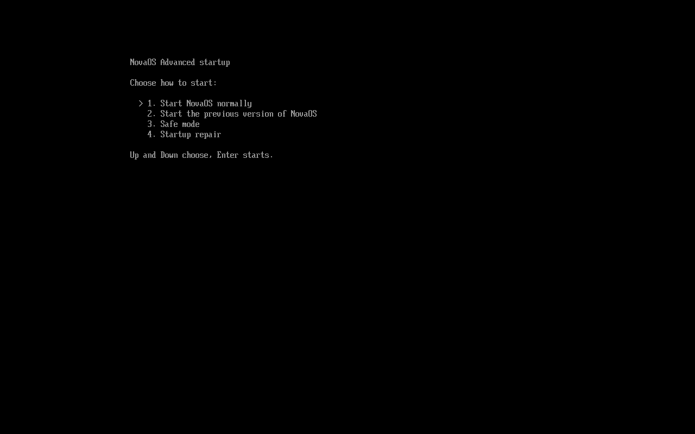

# Update rollback and recovery (roadmap step 33.3)

How an installed NovaOS gets back to a working system when an update, a
driver or a damaged disk stops it from starting, done the way Windows does
it: a known-good copy of the system kept beside the new one, automatic
rollback of an update that does not start, a restart after a stop error
instead of a halted PC, and a recovery boot with safe mode, startup repair
and reset. How updates are fetched and staged is in
[updates.md](../updates.md).

| Windows | NovaOS |
|---|---|
| The previous build kept for rollback (`Windows.old`, the servicing stack's pending.xml rollback) | `\EFI\NOVA\kernel.old`, the kernel an update replaced |
| Boot Manager's boot status: a boot that never reached logon counts as failed | the trying mark `\EFI\NOVA\update.try`, deleted only once the new kernel's desktop is up with someone signed in or the sign-in screen showing |
| "Automatically restart" after a stop error (on by default) | `KeFatalStop`: on an update's first start, a kernel stop restarts the machine |
| The hardware watchdog timer (WDAT), reset when the system stops answering | the chipset's TCO timer (`kernel/hal/tco.c`), running while an update first starts |
| Rollback of a feature update that fails to start | the boot loader starts the previous kernel, which removes the update |
| Windows Recovery Environment (WinRE) after two failed boots, F8, `shutdown /r /o` | the Advanced startup menu in `BOOTX64.EFI` (`bootloader/src/recovery.c`), after two failed starts (`\EFI\NOVA\starts.cnt`), F8 or `shutdown /r /o` |
| Boot manager's `bootstat.dat` (boots that never reached logon) | `\EFI\NOVA\starts.cnt`, one more at each start, deleted at the desktop |
| Safe mode (`SafeBoot\Minimal`: inbox drivers, Basic Display) | safe mode: NovaOS's own drivers, the firmware's framebuffer |
| Last Known Good, "Uninstall latest update" | "Start the previous version of NovaOS": `bootx64.old` starting `kernel.old` |
| Startup Repair (`SrtTrail.txt`) | startup repair, report in `C:\Windows\System32\LogFiles\Srt\SrtTrail.txt` |
| Reset this PC | (to do) |

## Done: a failed update comes back on its own

Before this step a broken update was rolled back only when something reset
the PC while the new kernel started: a kernel that stopped (a panic, a
failed assertion, a fatal CPU exception) printed its report and halted, and
the PC waited there until someone pressed reset. Now:

1. The boot loader starts `kernel.new` once with `BOOT_FLAG_UPDATE_TRIAL`
   after writing the trying mark (unchanged, [updates.md](../updates.md)).
2. Every fatal stop in the kernel (`KPANIC`, `KASSERT` and the page-fault,
   double-fault and unhandled-exception paths of
   `kernel/arch/x86_64/idt.c`) calls `KeFatalStop()` (`kernel/fs/update.c`)
   just before halting. On a trial start that has not finished the update
   yet, it logs
   `[UPDATE] The updated NovaOS X stopped while starting: restarting to go back to the previous version`,
   leaves the report on the screen for three seconds and resets the machine
   (`AcpiReset`: the FADT reset register, then port 0xCF9, the 8042 and a
   triple fault). On any other start it returns and the kernel halts as
   before, so a stop on a working system still leaves its report readable.
3. The trying mark is still on the ESP, so the boot loader starts the
   previous `kernel.elf` with `BOOT_FLAG_UPDATE_FAILED`, which deletes the
   update's files and says so on the App Store's Updates page.

### Testing it without a broken build

A kernel image has a second marked field next to its version stamp
(`NovaTestFault`, `kernel/ke/version.c`), empty in every build.
`tools/mkupdate.py --fail-boot panic` writes `panic` into it on the copy it
puts in a channel; such a kernel stops with a kernel panic just before it
enables interrupts and counts as started (`kernel/ke/main.c`). The devices
suite's `update` boot serves one as `broken/` (a v3 of the test versions):
it stages it, restarts, and passes when the broken kernel's stop, the
automatic restart and the previous version's start all appear in the serial
log with no reset from the test ([updates.md](../updates.md#the-self-test)).

## Done: an update that hangs or stalls comes back too

A kernel that hangs instead of stopping used to wait for a reset, and a
start counted as good as soon as the kernel enabled interrupts, long before
the desktop was up. Now an update's first start is watched until it
reaches the desktop:

1. **The point where a start counts as good** is the desktop: its loop has
   answered for three seconds with an account signed in or the sign-in
   screen showing (`UpdateDesktopTurn`, called from the desktop loop in
   `kernel/wm/desktop.c`), as Windows counts a boot as good at logon. Only
   then does the new kernel make itself the installed one and delete the
   trying mark. A PC with no screen counts as good once interrupts are on.
2. **A hang.** Right after the PCI scan, the trial start starts the
   chipset's watchdog timer (`kernel/hal/tco.c`, the TCO timer of Intel's
   ICH9 family, which QEMU's q35 machine has): it resets the PC
   `UPDATE_HANG_SECONDS` (60) after it was last reloaded. The kernel
   reloads it at each step of its start (ACPI and the display, the disks,
   the network and sound, the other processors, the desktop's start), and
   once threads run, the `update watch` thread reloads it every second. So
   the chipset resets the PC only when the kernel stops running its threads
   at all: a hang with interrupts off, or a deadlock that holds every
   processor. The timer is halted again once the update is finished.
3. **A stall.** A start that keeps running but never gets to the desktop (a
   driver waiting for a device forever, the desktop failing to come up) is
   caught by the same thread: when the start has made no step forward for
   `UPDATE_STALL_SECONDS` (90) it logs
   `[UPDATE] The updated NovaOS X made no progress for 90 s while starting (last step: ...)`
   and restarts the PC.

Either way the trying mark is still on the ESP, so the next start is the
previous version, which removes the update. On a PC whose chipset is not
of that family, or whose firmware locked the timer (the boot log says
`No hardware watchdog on this PC`), the stall check and the restart after a
stop still work; a hang with interrupts off then waits for a reset as
before.

The self-tests stamp two more test faults (`tools/mkupdate.py --fail-boot`):
`hang` hangs with interrupts off where `panic` stops, and `stall` never
starts the desktop. The devices suite's `update` boot stages each and checks
that the machine comes back as the previous version with no reset from
outside ([updates.md](../updates.md#the-self-test)).

## Done: the Advanced startup menu

The boot loader (`bootloader/src/recovery.c`) has a menu of its own, the
counterpart of Windows' Advanced Boot Options and of the recovery
environment that comes up after failed boots. On an installed disk it
shows before NovaOS starts:

- when **F8** is pressed or held as the loader starts (it looks for the
  key for 300 ms);
- when NovaOS asked for it: **`shutdown /r /o`** (advapi32's
  `InitiateShutdown` with `SHUTDOWN_RESTART_BOOTOPTIONS`, which
  NovaOS's `NtShutdownSystem` takes as its own action 3) writes the mark
  `\EFI\NOVA\recovery.req`, which the loader takes away again, as
  Windows sets a one-time boot of its recovery;
- **by itself after two failed starts.** The loader adds one to the count
  in `\EFI\NOVA\starts.cnt` at every start, and the kernel deletes the
  file once the start counts as good (the same point as an update's:
  the desktop has answered for three seconds with someone signed in or
  the sign-in screen up; `RecoveryStartGood`, `kernel/fs/recovery.c`),
  as Windows' boot manager counts boots that never reached logon. With
  two or more on the count the menu says
  `NovaOS didn't start correctly: the last 2 starts stopped before the desktop.`
  and runs startup repair unless something else is chosen within 30
  seconds.

Its lines (Up/Down or the number, then Enter):

1. **Start NovaOS normally.**
2. **Start the previous version of NovaOS**, when `kernel.old` is there.
   An update now keeps the boot loader it replaces as
   `\EFI\NOVA\bootx64.old` beside `kernel.old` (or deletes an older
   `bootx64.old` when the update brought no loader, so `kernel.old` goes
   with the current one): that pair is the known-good set. The menu starts
   `bootx64.old` with the load option `previous` (`LoadImage` and
   `StartImage`, as a firmware boot entry would), and that loader starts
   `kernel.old` without a menu; without `bootx64.old` this loader starts
   `kernel.old` itself. Either way it is once (`BOOT_FLAG_PREVIOUS`): the
   next start is the installed version again. A `kernel.elf` that is not
   an x86-64 ELF executable at all starts `kernel.old` this way by itself,
   with startup repair.
3. **Safe mode** (`BOOT_FLAG_SAFE_MODE`): no Windows driver package's
   `.sys` loads (`kernel/nt/ldr.c` logs
   `[NT] X: not loaded in safe mode` and the device stays without a
   driver, as Windows' `SafeBoot\Minimal` starts inbox drivers only); the
   display uses the firmware's framebuffer with no adapter driver
   (`kernel/hal/display.c`), as Windows' Basic Display; the desktop is
   black with "Safe Mode" in its corners.
4. **Startup repair** (`BOOT_FLAG_STARTUP_REPAIR`): once interrupts are on
   a thread checks the EFI System Partition's file system (lost clusters
   freed, `FatReclaim`), puts back a damaged or missing
   `\EFI\BOOT\BOOTX64.EFI` from `bootx64.old` and a damaged or missing
   `kernel.elf` from `kernel.old`, removes an unfinished or staged update
   (it can be installed again), clears the failed-start count, and writes
   what it found to `C:\Windows\System32\LogFiles\Srt\SrtTrail.txt`, the
   file Windows' Startup Repair writes. The start then goes on.

The kernel's side is `kernel/fs/recovery.c` (`recovery.h`). Every user of
the ESP (staging an update, finishing one, the count, startup repair) now
takes it one at a time (`UpdateEspOpen`/`UpdateEspClose`,
`kernel/fs/update.c`).

### The boot test: rollbacktest

The devices suite's `rollbacktest` boot starts a copy of `build/nova.img`
with `kernel.old` (this build stamped `0.0.9-test` by
`tools/mkupdate.py`), `bootx64.old` and the files of an update that never
finished. It restarts with `shutdown /r /o` and picks safe mode (the log
shows safe mode and the GOP framebuffer), then startup repair (its report
says it removed the unfinished update), then the previous version (`ver`
says 0.0.9-test), restarts normally, and last resets two starts before
they reach the desktop: the third shows the menu by itself and runs
startup repair. Together with the `update` boot's broken updates, this is
33.3's "Done when".

## To do

1. **The ACPI WDAT table.** Drive the watchdog Windows uses where firmware
   describes one, beside the ICH9 TCO timer.
2. **Reset this PC**: reinstall from the running kernel and keep
   `C:\Users`.
3. **Settings > System > Recovery**: an "Advanced startup: Restart now"
   button (today `shutdown /r /o` in the Terminal).

The Advanced startup menu is separate from the boot menu step 33.4 part 2
added (`bootloader/src/bootmenu.c`, which lists Windows Boot Manager when
Windows is on the PC: [installer.md](installer.md)), as Windows keeps its
boot manager and its Advanced options apart: that menu shows first, and
the Advanced startup menu after it when it is asked for.
