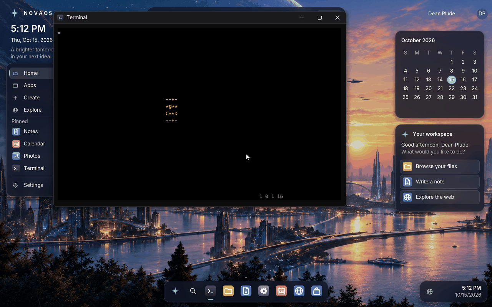

# DOS programs

Windows ran 16-bit DOS programs through NTVDM, the NT Virtual DOS
Machine: a DOS kernel and a PC BIOS in a process of their own, with the
program's console in a normal window.  NovaOS takes the same route
(roadmap Phase 31), with one difference: NTVDM put the processor into
virtual-8086 mode, which x86-64 long mode does not have, so NovaOS runs the
DOS on a small real-mode CPU instead.

The DOS is **MS-DOS 4.00**, built from the source Microsoft published under
the MIT licence at
[github.com/microsoft/MS-DOS](https://github.com/microsoft/MS-DOS)
(`v4.0/src`; versions 1.25 and 2.0 in the same repository are historical
and not complete enough to build).  NovaOS uses it unchanged.

## Step 31.1: building it from source

`tools/msdos/build_msdos.py OUTDIR` builds the tree the way it was built in
1988.  The tree carries its own build tools as DOS programs (`v4.0/src/TOOLS`:
MASM 5, the Microsoft C 5 compiler, LINK, NMAKE, EXE2BIN and the message
tools), so the script runs the tree's own top-level `NMAKE` in DOS.  The DOS
for the build is DOSBox, Ubuntu's `dosbox` package run headless; it is a
build tool only, like a compiler, and nothing of it ends up in NovaOS.

The script fetches the pinned commit of the repository into
`~/.cache/novaos/msdos` and copies `v4.0/src` into a work directory as a
DOS disk would hold it.  Two things differ from the repository, and nothing
else:

- **Line ends.**  The repository stores text with LF only.  MASM and NMAKE
  read that, but EXE2BIN reads its answer to "Fix-ups needed - base segment
  (hex):" from `BIOS\LOCSCR` and waits for a carriage return forever
  without one, so every text file gets DOS line ends (CR LF).
- **Lost characters.**  The publication turned the code page 437 bytes of
  some files (box-drawing characters, mostly in comments) into the
  three-byte UTF-8 replacement character.  In `MAPPER\GETMSG.ASM` that grows
  a comment line past MASM's 128-character limit ("error A2106: Line too
  long").  Each replacement character becomes one byte, `C4h` (`─`).

The build takes under two minutes and produces the 63 files the tree's
`CPY.BAT` gathers (`IO.SYS`, `MSDOS.SYS`, `COMMAND.COM`, the utilities and
device drivers) plus the boot sector, `MSBOOT.BIN`.  The result is kept in
`~/.cache/novaos/msdos/out-HASH`, with NMAKE's output as `BUILD.LOG`, and
reused while the script is unchanged.

`tools/msdos/boot_test.py OUTDIR` checks that the result is a working DOS:
it formats a 1.44 MB floppy image with mtools using the built boot sector
(setting its BIOS drive number to 0 as `FORMAT` does for a floppy), copies
`IO.SYS` and `MSDOS.SYS` first, as `SYS` does, then `COMMAND.COM`,
`MEM.EXE` and an `AUTOEXEC.BAT`, and boots it in QEMU.  The batch file sends
the output of `VER`, `DIR` and `MEM` to the first serial port; the test
passes when "MS-DOS Version 4.00", the listing and MEM's memory report
arrive.

CI runs both in the **MS-DOS 4.0** job (not a required check) and keeps the
files as the `msdos` artifact ([ci.md](ci.md)).  Locally:

```sh
sudo apt install dosbox mtools qemu-system-x86
python3 tools/msdos/build_msdos.py build/msdos
python3 tools/msdos/boot_test.py build/msdos
```

## Step 31.2: DOS in a console window

Type `ntvdm` in the Terminal and MS-DOS boots in the window to `A:\>`;
**F12** ends it and gives the Terminal back (the `COMMAND.COM` DOS boots
to is its primary shell, which has no `EXIT`, as on a PC).  `ntvdm IMAGE`
boots another floppy image instead.

**The disk.**  The build runs `build_msdos.py` (so `dosbox` is one of the
build's packages, [building.md](building.md)) and `tools/msdos/mkdisk.py`
makes a 1.44 MB boot disk of the result: the boot sector, `IO.SYS` and
`MSDOS.SYS` first as `SYS` puts them, then `COMMAND.COM` and the other 59
files, all of MS-DOS 4.00 (1.1 MB), and an `AUTOEXEC.BAT` that sets the
prompt (`PROMPT $P$G`) and runs `REDIR.COM` (step 31.3).  NovaOS keeps it as
`C:\Windows\System32\DOS\MSDOS.IMG`, beside `LICENSE.TXT`, Microsoft's
MIT licence.  `ntvdm.exe` reads the image into memory; what DOS writes to
the disk stays there and the file is not changed.

**The CPU.**  `userland/programs/ntvdm/cpu86.c` interprets the 8086's
instruction set with the 80186's additions (`PUSHA`, `PUSH` immediate,
three-operand `IMUL`, shifts by an immediate count, `ENTER`/`LEAVE`,
`BOUND`, `INS`/`OUTS`), in real mode with 1 MB of memory (addresses wrap
at 1 MB, A20 off).  Its flags read as an 8086's, so programs that look for
a 286 find an 8086 and do not try protected mode; there is no 8087 (ESC
instructions do nothing, and the equipment word says so).  It is NovaOS's
own code under the repository's MIT licence: the free interpreters are
GPL (DOSBox, 86Box, emu2), and Microsoft publishes no real-mode CPU under
the MIT licence (OpenVMM's `x86emu`, in Rust, emulates single instructions
for a hypervisor's exits rather than running a CPU).

**The BIOS.**  `pcbios.c` is the PC around the CPU: 640 KB, the interrupt
controller, timer, CMOS clock and keyboard controller ports, and a BIOS
written in C.  As in NTVDM, the ROM's interrupt vectors point at stubs
`BOP nn; IRET` (BOP is `C4 C4 nn`, an `LES` with a register operand that no
program uses), and the CPU calls into C for them:

| Interrupt | What it does |
|-----------|--------------|
| 10h | Colour text mode, 80 x 25, eight pages at B800:0: cursor, scrolling, characters and attributes, teletype output, write string |
| 11h, 12h | One floppy drive, colour 80 x 25, no 8087; 640 KB |
| 13h | Drive A: is the image (160 KB to 2.88 MB, geometry from its size): read, write, verify, drive parameters (and the diskette parameter table, INT 1Eh) |
| 14h | COM1 out: `ntvdm` writes what DOS sends to `AUX` to the debug log |
| 15h | No extended memory; the rest "not supported" |
| 16h | The keyboard buffer at 40:1E: read (waiting), peek, shift state, the 101-key calls |
| 17h | A printer that is always ready |
| 19h | Boot: the image's boot sector to 0:7C00 |
| 1Ah | The tick count, and the date and time from NovaOS's clock |

The timer interrupt (IRQ 0, 18.2 times a second) keeps DOS's clock and
`INT 1Ch` going.  When DOS waits for a key the CPU stops and `ntvdm.exe`
sleeps until a key or the next tick, so an idle DOS prompt costs nothing.

**The console.**  `ntvdm.exe` draws the text screen on the console's
alternate screen with `WriteConsoleOutputW`, code page 437 turned into
Unicode (box drawing, accented letters) and the colour attributes kept as
they are (the CGA's colour bits are the console's).  Keys come from
`ReadConsoleInputW` with the console's processing off, so Ctrl+C reaches
DOS; each becomes the scan code and character a PC keyboard gives (US
layout), and arrows, Home, End and the function keys their extended codes.

**Tests.**  The `dostest` self-test (core boot) starts `ntvdm.exe` in the
Terminal, waits for the prompt, types `VER` and `DIR` and reads the
answers off the console, then presses F12.  CI's MS-DOS job builds the
same CPU and BIOS for Linux with `tools/msdos/vdm_test.c` as the host and
boots the disk in seconds (`tools/msdos/vdm_test.py`): `VER`, `DIR`,
`MEM`, `CHKDSK`, a `COPY` and `TYPE`, and a `DEBUG` session that assembles
and runs a `MUL` and checks its 32-bit product and flags.

## Step 31.3: DOS programs as Windows programs

A DOS program starts the way a Windows program does: type `prog` or
`prog.exe` in `cmd` or the Terminal, double-click it in File Explorer, or
call `CreateProcess` on it.  It runs in the console window with drive C:
as NovaOS has it and its current folder as DOS's, and when it ends the
console is Windows' again: what it printed stays on the screen and its
exit code is the process's (`%ERRORLEVEL%` in `cmd`).

**Starting it.**  As Windows starts `ntvdm.exe` for a 16-bit image, the
kernel's process start (`UmDosHost` in `kernel/um/um.c`, which
`CreateProcess`, the Terminal and Explorer all go through) sees a DOS
program and starts `C:\Windows\System32\ntvdm.exe -run "PATH" ARGUMENTS`
instead.  A DOS program is an `MZ` image with no Windows header after the
DOS one (no `PE`, `NE`, `LE` or `LX` signature at `e_lfanew`), or a `.COM`
file that does not start with `MZ` (Windows' own `.com` programs are PE
images and run as themselves).  The Terminal looks for `NAME.com` before
`NAME.exe`, as `cmd`'s `PATHEXT` does, and Explorer opens a `.com` file as
a program.

**Drive C:.**  DOS reaches C: through its own network redirector
interface, as NTVDM's `REDIR` did, rather than through a disk image of
NovaOS's files: a drive whose current directory structure (CDS) is marked
"network" sends every operation (open, create, read, write, find first and
next, make and remove directory, rename, delete, attributes, free space) to
`INT 2Fh` with `AH=11h`, and the BIOS's handler answers them from NovaOS's
files (`userland/programs/ntvdm/redir.c`).  Nothing is copied, so what DOS
writes is on C: at once and what NovaOS changes DOS sees at once.  The
layouts it reads and fills (the swappable data area, the system file table
entry, the CDS) are MS-DOS 4.00's, from its source and the build's
`MSDOS.MAP`.

DOS sees 8.3 names.  A NovaOS name that fits is shown in capitals
(`readme.txt` is `README.TXT`); one that does not gets an alias as
Windows makes them: six characters of the name, `~` and a number in the
order the folder lists them, and three of the extension (`My DOS
programs` is `MYDOSP~1`).  The other drives are not shown to DOS; a
program on one does not start.

**REDIR.COM.**  The boot disk's `AUTOEXEC.BAT` runs `REDIR.COM`, a small
program `tools/msdos/mkdisk.py --novaos` assembles onto the disk.  It
hands the BIOS DOS's list of lists and swappable data area (`BOP 60h`);
the BIOS marks C: as a network drive with NovaOS's current folder as its
directory and puts its `INT 2Fh` handler in front of DOS's.  Started with
`-run`, the BIOS also gives REDIR the program, its command tail and C: as
the current drive, and REDIR runs it with `EXEC` (`INT 21h AX=4B00h`, the
command tail's file names parsed into the FCBs as `COMMAND.COM` does),
reads its exit code (`AX=4D00h`) and tells the BIOS it ended (`BOP 61h`).
`ntvdm.exe` then leaves the alternate screen, writes the lines the program
left on the DOS screen into the console and exits with the program's exit
code.  Running the program itself rather than `COMMAND /C` keeps its exit
code: `COMMAND.COM` 4.00 does not pass a child's on.  Typed `ntvdm`
without `-run` still boots to `A:\>`, now with C: there too.

**Tests.**  `dostest` writes `DOSRW` (`userland/programs/ntvdm/dosrw.h`), a
small program that reads `IN.TXT`, writes `OUT.TXT` and ends with exit code
42, into a folder with a long name as `dosrw.com` and `dosrwexe.exe`;
`cmd /c dosrw IN.TXT` must run the `.COM` by name and return 42 with
`OUT.TXT` written and the message left on the screen, and `CreateProcess`
the same for the `.EXE`.  CI's MS-DOS job runs both on the CPU and BIOS
built for Linux with a directory as drive C:, then types `C:`, `CD` into
the folder by its alias, `DIR`, `TYPE`, `COPY`, `MD`, `RD`, `REN`, `DEL`
and `MEM` from C: at the prompt (`tools/msdos/vdm_test.py`).

## Step 31.4: a game, and what runs



**A game.**  bootRogue by Oscar Toledo G.
([github.com/nanochess/bootRogue](https://github.com/nanochess/bootRogue),
BSD 2-clause licence) is a roguelike in 510 bytes of 8086 code, the kind of
program NTVDM had to run as well as DOS's own: it sets the text mode with
`INT 10h`, writes its dungeon straight into video memory at B800:0 rather
than through DOS or the BIOS, takes its random seed from the timer chip's
counter (port 40h) and reads the arrow keys with `INT 16h`.  Its source is
in `third_party/bootrogue`, unchanged; the build assembles it with NASM as
a `.COM` and ships it as `C:\Tests\Dos\ROGUE.COM` with its licence.
Type `C:\Tests\Dos\ROGUE` in the Terminal to play: the arrow keys move
the smiling face (light shows the room you are in), walking into a letter
fights a monster, the numbers at the bottom right are level, weapon,
armour and HP, and Esc gives the Terminal back.

**The window.**  A DOS screen is 80 x 25, and the Terminal's window had
21 rows, so a program's last rows (bootRogue's status line) were cut off.
When a program takes the whole console (it reads keys one at a time, as
`ntvdm.exe` does), the Terminal now grows its window to at least 80 x 25,
as a Windows console window is, and `ntvdm.exe` draws the whole screen
again when the console's size changes.  The Terminal draws characters
from the monospace font's ASCII: box drawing as lines and corners, the
smiling faces as `@` and other picture characters as stand-ins, while the
console itself keeps the real characters (what `ReadConsoleOutput` and the
tests read).

Making the game run also found a bug in step 31.3's drive C:: the alias
for a long name with a six-character stem and an extension
(`ROGUE-LICENSE.TXT`, `ROGUE-~1.TXT`) overran a ten-byte buffer in
`redir.c`, and DOS could not find anything in that folder.  And
`ntvdm.exe` wrote a NUL after the sequence that opens the alternate
screen; the Terminal's copy of program output on the serial port (what
the self-tests read) stopped at it, so on fast runs everything read in the
same chunk after it, `dostest`'s summary included, went missing.  The
sequence is written without it, and that copy now skips a NUL instead of
stopping.

**Tests.**  `dostest` starts `ROGUE.COM` with `CreateProcess`, waits for
the hero (U+263A in the console, code page 437's `01h`) and the HP, plays
eight moves with the arrow keys and presses Esc, which must end it with
exit code 0 and give the console back; the core boot's screenshot of it is
`docs/screenshots/dos-bootrogue.png`.  CI's MS-DOS job plays it on Linux
too, through `vdm_test`'s new `screen=` (text on the screen, read from
video memory) and `key=` (arrows and Esc) steps, and writes a file in
`EDLIN` at the prompt.

**What runs.**  These have compatibility entries
([compatibility.md](compatibility.md)):

| Program | Rating | Checked by |
|---------|--------|------------|
| MS-DOS 4.00's `COMMAND.COM` and its utilities (`DIR`, `COPY`, `TYPE`, `MEM`, `CHKDSK`, `DEBUG`, `EDLIN`) | Gold | `dostest` and CI's MS-DOS job |
| bootRogue | Platinum | `dostest` and CI's MS-DOS job |

The utilities are Gold rather than Platinum because of what the DOS host
does not have yet: graphics modes (CGA, EGA, VGA), sound, a mouse,
expanded and extended memory, and keyboard layouts other than US.  The
4.00 source has no `EDIT` or `QBASIC` (they came with MS-DOS 5).

## What comes next

Phase 31 is done.  Graphics modes, the PC speaker and a mouse for DOS
games, and other keyboard layouts, would be the next steps if DOS games
become a target; none is on the roadmap yet.

The steps and what counts as done are in [ROADMAP.md](ROADMAP.md#phase-31-dos-programs).
