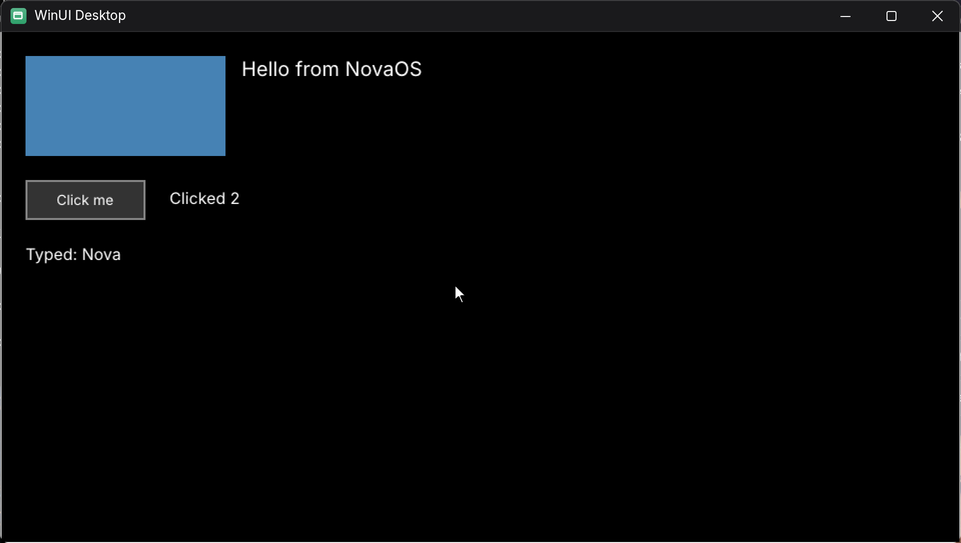

## A XAML page takes input

The eighth and last part of step 32.4 of `Windows.UI.Xaml` on NovaOS
([design](../design/windows-ui-xaml.md)), in the Starlight 0.2.1 push: a
WinUI 3 page is clicked and typed into, built from Microsoft's sources.

- **Input:** the island's pointer and keyboard messages reach the
  framework's input manager through its browser host's input entry
  points, with the core's pointer, key and character event args, the
  interaction manager and Microsoft's gesture component.
- **NovaOS's side:** its own `Microsoft.UI.Input.GestureRecognizer`
  (taps, double taps, right taps, translation manipulations), its own
  `ElementSoundPlayerService` entry points (a desktop plays no element
  sounds by default), and `dcomp.dll`'s new nine-grid brushes, which a
  pressed `Button`'s border is drawn with.
- **Test:** `xamlpagetest` reads the `Border`'s colour back from the
  window, clicks the `Button` with the mouse and with Space (its `Click`
  fires both times) and types "Nova" into the page (64-bit).
- **Next:** a `TextBox`, which loads `WinUIEdit.dll`, a closed windowless
  RichEdit NovaOS will provide.
